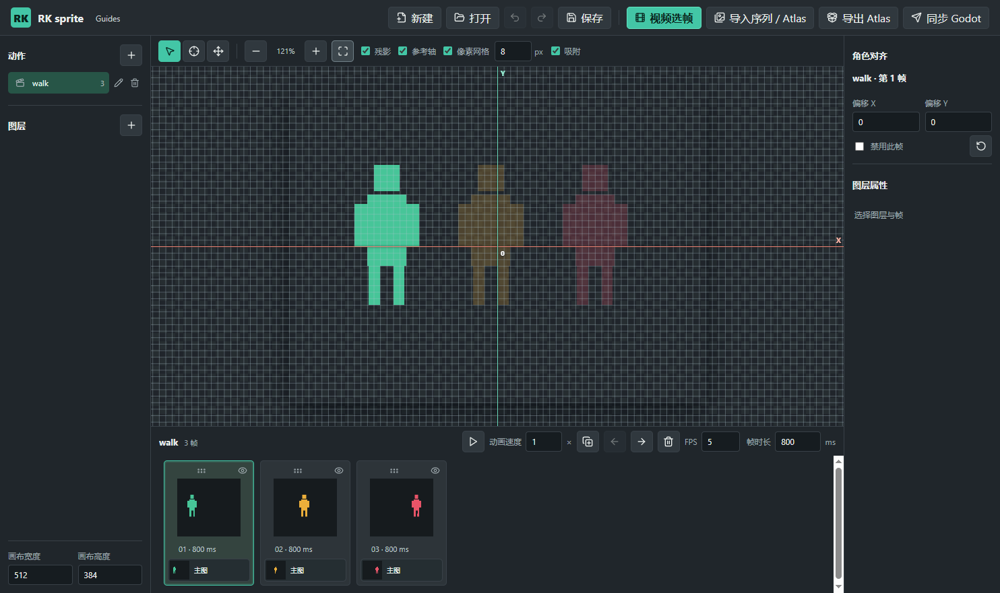

# RK sprite

独立、离线的 Windows 2D 精灵动画与换装素材桌面工具。与 XSXB Frame Tuner 分开维护，不读取或修改其工程。

## 启动

从 GitHub Releases 下载 `RK-sprite-v0.1.0-win64.zip`，解压后运行其中的 `RK sprite.exe`；请保留解压后的整个文件夹。使用时不需要联网，也不需要启动网页服务。工程以 `.rksprite` 保存，素材位于工程文件旁的 `assets/`。

从源码运行需要 Node.js 和 npm：`npm ci`，然后 `npm start`。构建 Windows 便携版使用 `npm run package:win`，产物在 `out/build/`。

## 制作流程

1. 新建 `.rksprite` 工程；素材保存在工程文件旁边的 `assets/` 中。
2. “视频选帧”选择本地视频及时间范围，可设置“每 X 秒取 Y 帧”：每段内等间距抽取并自动保留；也可按采样帧率提取候选帧再手动筛选。点击缩略图可预览原尺寸画面，放大按钮可让视频或选中帧占满窗口；勾选框控制保留，右侧可调整顺序。生成动作时选中的帧会以原分辨率写成 PNG。同名动作会覆盖旧动作，并清除旧帧关联的图层绑定，其他动作不受影响。
3. “导入序列 / Atlas”接受多张 PNG、单张网格 PNG，或 PNG+JSON 图集。单张图会先打开网格切分预览，可填写单帧宽高、边距、间距和帧数。JSON 支持 RK sprite、Aseprite/TexturePacker 的逐帧矩形及裁边位置；旋转打包暂不支持。
4. 每个动作拥有独立的装备层和“仅预览”层。可给当前帧绑定 PNG，给全部帧绑定一张固定装备图，也可给当前动作导入等量 PNG、网格图或 Atlas。时间轴的每张帧卡分别显示主图和该帧各图层。拖动帧卡顶部的拖动柄或主图，放到目标卡左/右侧即可改变帧顺序；主图、所有图层绑定、帧时长和来源时间一起移动。将 PNG 拖到帧卡中的图层小卡，只替换那一帧；将 Atlas 拖到图层列表或右侧属性区，则导入当前动作的选中图层。
5. 选中帧后，在右侧可逐帧设定“在角色后方”与“禁用此帧”。禁用帧仍留在工程里供编辑，但播放与导出时跳过。装备图层的“仅复制变换到有素材帧”只复制位置、旋转、缩放与锚点，不覆盖目标帧自己的图片和前后关系。
6. 若源帧的角色站位不齐，勾选“参考轴”显示视图区中心的 X/Y 十字轴与原点。轴线铺满整个视图区，不随图片缩放伸缩，标签大小不变；它不改变 Godot 导出时的底部中心原点。用四向箭头工具拖动角色，或选中帧卡中的“主图”后直接拖动，也可在右侧输入当前帧偏移 X/Y。装备和预览图层会跟随角色整体移动。
7. “像素网格”在各个缩放比例下都可见，以半透明细线叠在图上，不自动改变视角。“px”设置每格的画布像素数，默认 8，可改为 1；同时勾选“吸附”，移动主图的底部中心或图层锚点就会落到同一画布网格上，拖动时小方框标出落点。缩得很小时只绘制较粗的主格线，吸附仍使用所填步长，输入框悬停可查看实际显示间距。关闭“吸附”或网格后可按 0.01 像素自由移动；开关本身不移动任何图片。
8. 残影、参考轴与像素网格在播放时同样有效。残影显示前后有效帧，跳过禁用帧并在循环边界衔接。三种辅助显示都不会进入导出的 Atlas 或 Godot；角色偏移和图层变换仍会烘焙到图片。
9. 保存工程并导出。每个动作有身体 Atlas，非空装备层有各自独立的 Atlas 与 JSON 索引，记录装备槽、逐帧前后关系、帧区域、帧时长和统一画布原点。预览层不导出。

工程、视频、PNG/Atlas 都可以直接拖进窗口打开；文件选择器会分别记住上一次打开项目、视频和序列素材的目录，重启后仍有效。动作和图层列表旁可编辑名称或删除，删除前会确认；素材文件不会被自动删除。时间轴的“动画速度”是当前动作保存的 0.1–8 倍播放倍率：RK sprite 预览和同步到 Godot 后的播放一致。每帧原始时长仍保留，例如 83 ms、2× 会以约 41.5 ms 播放。旧工程未设置倍率时默认为 1×。保存成功后顶部工程名旁持续显示“已保存”，再次编辑后消失。关闭窗口时若有未保存修改，可选择保存并退出、放弃并退出或取消。

顶部的撤销/重做按钮支持最多 80 步工程编辑，快捷键为 `Ctrl+Z`、`Ctrl+Y` 或 `Ctrl+Shift+Z`。动作、帧、图层、素材绑定及变换都可撤销；撤销后继续修改会清除原来的重做分支。保存不会清空历史，但关闭或切换工程后历史从当前工程重新开始。撤销导入只移除工程中的引用，不删除已写入磁盘的素材文件。

循环预览按逐帧时长播放，不在循环边界额外停顿。视频提取的候选帧由你自行筛选和调整，工具不会自动删除重复画面。

图层可在当前动作内调整前后顺序；当前帧图层可复制/粘贴、单帧清除或应用到所有帧。图层的前后复选框按帧保存，未设置的旧帧沿用原图层默认值。选择工具下可拖动当前图层位置，按住 R 滚轮旋转、按住 Z 滚轮缩放；对齐工具则移动当前帧角色和所有图层。

## 同步到 Godot

点击顶部“同步 Godot”，选一个包含 `project.godot` 的工程目录。软件先保存当前工程，再把可播放的身体和装备图集、`animation.json` 及 `player.tscn`、`preview.tscn` 写到该 Godot 工程的 `res://rk_sprite/<工程名_标识>/`；通用脚本放在 `res://rk_sprite/runtime/rk_sprite_player_v2.gd`。可在 Godot 中运行 `preview.tscn` 预览，或将 `player.tscn` 实例化进自己的角色场景。此前由工具生成且未修改的 v1 场景会自动升级为 v2，旧脚本不删除。同步不修改项目入口、既有角色场景或游戏逻辑；若同名运行脚本/场景已被手工改写，将拒绝覆盖。

运行时通过 `play_animation("run")` 播放、`play_animation("attack", false, true)` 重播一次性动作，通过 `set_equipment("upper", "Coat")` 选择同槽位装备、`set_equipment("upper", "")` 脱下；装备名字要在对应动作中存在。`available_equipment("upper")` 可查询名称。重复调用当前动作不会回到第一帧。帧时长、禁用帧、角色对齐以及逐帧前后层级与 RK sprite 导出一致；运行时只处理视觉播放和换装，**不自动接入移动、攻击判定或你已有的游戏状态机**。仅预览的武器/特效层依旧不导出。

画笔、橡皮和新建绘制层已移除。旧工程中的绘制层仍可显示和导出，但不可继续编辑；升级不会主动删除原素材。

该版本不会自动去除视频背景，不会从合成画面里智能拆分身体与服装，也不会把仅预览的武器或特效绑定到 Godot。视频解码依赖桌面窗口自带的编解码支持；不支持的格式需要先转换。导出的身体图保留原视频背景，尚未提供自动抠图。

## 与原网页版对照

本版已恢复与这次制作流程相关的逐帧图层卡、前后层级、当前帧素材拖入、图层复制粘贴、当前帧移除、位置/旋转/缩放、视频选帧与 Atlas 导入。旧版 `.rksprite` 工程中的全局图层会在打开时按帧所属动作拆分；无法归属的旧绑定保存在 `legacyLayers` 中，不会直接丢弃。

仍未移植 XSXB 网页版的碰撞/攻击/受击框、帧 SFX、攻击拖尾编辑、参考帧和 Unity 同步。RK sprite 现可向 Godot 项目生成独立视觉播放场景，但不会自动把它接进任意既有游戏角色逻辑。

## 测试

`npm test` 检查工程结构、旧工程迁移、Atlas、抽帧、编辑历史与 Godot 同步边界。桌面测试为 `npm run smoke`、`smoke:atlas`、`smoke:features`、`smoke:guides`、`smoke:history`、`smoke:playback`、`smoke:drop` 和 `test:close`。`smoke:features` 在检测到 Godot 4.x 可执行文件时运行隔离工程的实际播放测试；如果 Godot 不在 PATH，可设置 `GODOT_EXE` 为其可执行文件路径。

## English

RK sprite is an offline Windows desktop editor for 2D frame animations and layered outfits. Import a video and select frames, or import PNG sequences, grid sheets, and JSON atlases. Align frames on a shared canvas, preview equipment per frame, adjust timing and animation speed, and export separate body/equipment atlases.

Download the portable ZIP from Releases, extract the whole folder, and run `RK sprite.exe`. To run from source, use Node.js with `npm ci` and `npm start`. You can sync visual playback data and a reusable scene to a selected Godot 4 project; existing character controllers and gameplay systems are **not** connected automatically. Preview-only weapon/effect layers are not exported. No automatic background removal or duplicate-frame deletion is performed.
